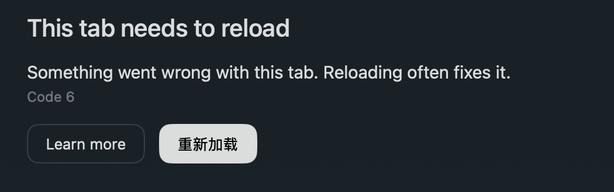
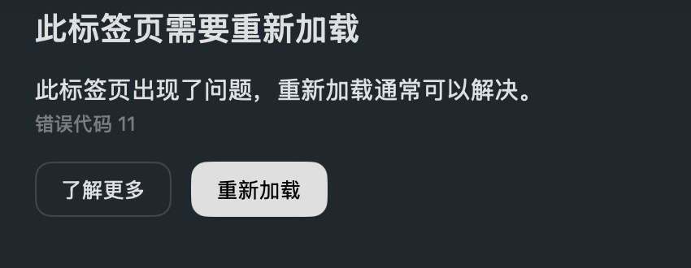

## What

Add restart-based interface language selection: Follow System, English and Simplified Chinese. Localize DiaTweaks controls, supported native Dia surfaces and Chromium resources through an embedded catalog.

## Why

Dia's native UI remains English on a Chinese system. Shared locale resolution and scoped adapters let additional languages reuse the same integration.

## Proof

Native error page before and after:

The before image is a user-reported code 6 failure; the after image uses a disposable chrome://crash tab (code 11). The diagnostic numbers are preserved, not translated into different values. Images are cropped to exclude browser content and account details.

Further per-surface verification and limits are recorded in [localization-validation.txt](localization-validation.txt). The language selector takes effect after restart; no new animation is added. A recording of repeated settings navigation and tooltip reuse is still needed before submission if presenting the earlier flicker/performance fix as changed transition behaviour. Screenshots alone do not prove that behaviour.

## Tested on

- Dia: 1.57.1 (90935), arm64
- macOS: 26.5.2 (25F84)
- Build/install: make, ./install.sh --yes
- Checks: make check; scripts/check-tweak-docs (81 existing tweaks)
- Live regression: sidebar and top layouts, 115 scenarios each, zero problems after the native-adapter split. The final header-only class-name centralization was also checked in the top-layout run.
- Limits: untriggered cross-device error screens, unavailable profile 2–9 shortcut rows, and some physical hover states are not claimed as live verified. Illustration pixels retain English.

## Checklist

- [x] I tried to break this and fixed what I found
- [x] It works with tabs in the sidebar and tabs at the top
- [x] It works with each tweak on and off
